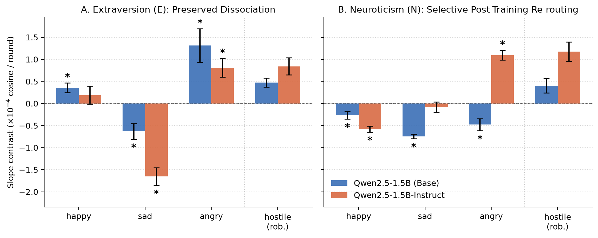

# Persona × Emotion-Concept Dynamics Lab

Code and data for studying how persona conditioning modulates internal emotion-concept trajectories in language models across repeated task failures.

This repository builds on:
> **Persona Prompts Modulate Internal Emotion-Concept Dynamics in a Language Model**  
> Lia Lind · *NeurIPS 2026 Workshop on Interpretability as a Science*

---

## Featured Experiment: Matched Base vs. Instruct Replay (`experiments/base_instruct_replay`)

### Question
In the workshop paper, conditioning an instruction-tuned model on everyday personality descriptions (such as Extraversion—seeking social conversation, with no mention of anger, sadness, or task performance) systematically modulated how its internal emotion-concept representations evolved over five consecutive rounds of task failure, slowing the rise of withdrawal-oriented concepts (`grief-stricken` / `sad`) while accelerating approach-oriented anger (`furious` / `angry`).

Here we ask **how post-training (`Base` $\to$ `Instruct`) reshapes these multi-round trait-to-emotion trajectory couplings**:
1. Does the coupling between broad persona traits and approach-vs.-withdrawal failure trajectories already exist in the pretrained base model, or is it introduced by instruction tuning?
2. When post-training shapes an assistant persona, does it uniformly scale these internal failure dynamics, or selectively re-route how specific traits accumulate across emotion channels?

### Design
- **Checkpoints**: `Qwen/Qwen2.5-1.5B` (pretrained base) and `Qwen/Qwen2.5-1.5B-Instruct`.
- **Activation readouts & cross-checkpoint alignment**: The workshop study used `mufxio/emotion-vector-bench` (Layer 17: `joyful`, `grief-stricken`, `furious`), which only released vectors for `Qwen2.5-1.5B-Instruct`. To compare Base and Instruct with checkpoint-matched probes extracted under an identical protocol, we use the published comprehension vectors from [`JihoonJeong/Neural-MRI`](https://github.com/JihoonJeong/Neural-MRI) (`538b8af`) at each checkpoint's externally selected best layer (`15/28`), where the corresponding positive, low-arousal negative, and high-arousal negative concepts are `happy`, `sad`, and `angry` (plus `hostile` as an anger-adjacent robustness readout). Because `Instruct` is post-trained directly from `Base`, the two checkpoints' layer-15 concept directions remain tightly aligned in $\mathbb{R}^{1536}$ (direct cosine similarity $+0.950$ for `happy`, $+0.957$ for `sad`, $+0.947$ for `angry`, $+0.954$ for `hostile`), and cross-scoring Base directly with the workshop paper's Layer-17 `Instruct` probe (`joyful / grief-stricken / furious`) reproduces the same Extraversion dissociation.
- **Stimuli & fixed failure trajectories**: 12 length-controlled first-person persona descriptions ($2 \times 2$ Extraversion $\times$ Neuroticism across 3 parallel wording templates) crossed with the 10 five-round Mastermind failure trajectories from the workshop study ($120$ runs per checkpoint).
- **Controlled pre-generation readout**: Both checkpoints read identical first-person transcripts and are scored via forward passes at the exact pre-generation boundary (`My next guess will be:`) at rounds 1–5, removing generation divergence.

---

### Key Findings



1. **Pretraining already couples everyday social traits to approach-vs.-withdrawal trajectories under failure (Panel A)**  
   Even in the pretrained **Base** model—and even in a non-social number-guessing task—higher Extraversion slows the rise of `sad` ($-0.632 \times 10^{-4}$/round, Holm $p = .018$) while accelerating the rise of `angry` ($+1.315 \times 10^{-4}$/round, Holm $p = .027$) and `hostile` ($+0.476 \times 10^{-4}$/round, $10/10$ paths). All $9/9$ primary moderation cells (`E`, `N`, `E×N` across `happy`, `sad`, `angry`) survive Holm correction in the Base checkpoint.
2. **Post-training selectively re-routes Neuroticism toward anger/hostility rather than uniformly damping persona effects (Panel B)**  
   Instruction tuning preserves the qualitative Extraversion dissociation (`sad` $-1.654 \times 10^{-4}$, `angry` $+0.808 \times 10^{-4}$, `hostile` $+0.843 \times 10^{-4}$), but reorganizes Neuroticism (`N`):
   - In **Base**, high Neuroticism has a negative slope contrast on `angry` ($-0.479 \times 10^{-4}$, Holm $p = .027$) and `sad` ($-0.745 \times 10^{-4}$, Holm $p = .018$).
   - In **Instruct**, the `N` slope contrast on `sad` is attenuated near zero ($-0.081 \times 10^{-4}$, $p_{\text{Holm}} = .875$), while **`N` on `angry` flips sign to strongly positive** ($+1.094 \times 10^{-4}$, $10/10$ paths positive, Holm $p = .018$), with a matching nearly threefold increase on `hostile` ($+0.403 \times 10^{-4} \to +1.173 \times 10^{-4}$).

#### Summary Table: Mean Slope Contrasts ($\times 10^{-4}$ cosine / round)

Asterisks (`*`) mark primary contrasts surviving 9-test Holm step-down correction ($\alpha = .05$) across the 10 trajectory blocks via two-sided exact sign-flip tests (`paths +/−` shows sign counts across the 10 trajectories).

| Concept | Effect | Base (`Qwen2.5-1.5B`) | Paths `+ / −` | Instruct (`Qwen2.5-1.5B-Instruct`) | Paths `+ / −` |
|---|---|---:|---:|---:|---:|
| `happy` | Extraversion ($E$) | $+0.357^*$ | `9 / 1` | $+0.188\phantom{^*}$ | `4 / 6` |
| `happy` | Neuroticism ($N$) | $-0.263^*$ | `0 / 10` | $-0.581^*$ | `0 / 10` |
| `happy` | Interaction ($E \times N$) | $+0.425^*$ | `10 / 0` | $+0.236^*$ | `9 / 1` |
| `sad` | Extraversion ($E$) | $-0.632^*$ | `1 / 9` | $-1.654^*$ | `0 / 10` |
| `sad` | Neuroticism ($N$) | $-0.745^*$ | `0 / 10` | $-0.081\phantom{^*}$ | `4 / 6` |
| `sad` | Interaction ($E \times N$) | $-0.355^*$ | `0 / 10` | $-0.299^*$ | `2 / 8` |
| `angry` | Extraversion ($E$) | $+1.315^*$ | `8 / 2` | $+0.808^*$ | `8 / 2` |
| `angry` | Neuroticism ($N$) | $-0.479^*$ | `2 / 8` | $+1.094^*$ | `10 / 0` |
| `angry` | Interaction ($E \times N$) | $-0.295^*$ | `0 / 10` | $+0.101\phantom{^*}$ | `6 / 4` |
| `hostile` *(rob.)* | Extraversion ($E$) | $+0.476\phantom{^*}$ | `10 / 0` | $+0.843\phantom{^*}$ | `10 / 0` |
| `hostile` *(rob.)* | Neuroticism ($N$) | $+0.403\phantom{^*}$ | `8 / 2` | $+1.173\phantom{^*}$ | `8 / 2` |

---

## Repository Structure

```text
lab/
├── src/                                  # Shared model loader, activation probe, and permutation stats
│   ├── probe.py
│   └── stats.py
├── experiments/
│   └── base_instruct_replay/             # Matched Base vs. Instruct replay experiment
│       ├── data/                         # 12 first-person personas, 10 failure paths, Jeong layer-15 probes
│       ├── results/                      # Full 120-run JSONL readouts, JSON analyses, and Markdown tables
│       ├── figures/                      # Generated contrast plots
│       ├── replay_text.py                # First-person trajectory prompt builder
│       ├── run_replay.py                 # Forward-pass activation scoring CLI
│       ├── analyze_replay.py             # Path-block OLS & exact sign-flip analysis CLI
│       └── plot_contrasts.py             # Figure generation script
└── tests/
    └── test_base_instruct_replay.py      # End-to-end verification against stored readouts
```

---

## Quick Reproduction

Verify prompt boundaries, factorial contrasts, and exact numerical reproduction of the Base and Instruct analyses from the stored readouts (no GPU or model weights required):

```bash
pytest -q
python experiments/base_instruct_replay/plot_contrasts.py
```

To re-run the forward-pass scoring from local or Hugging Face checkpoints:

```bash
python experiments/base_instruct_replay/run_replay.py \
  --model Qwen/Qwen2.5-1.5B \
  --probe experiments/base_instruct_replay/data/probes/qwen2.5-1.5b-base-jeong-comprehension-layer15.npz \
  --output experiments/base_instruct_replay/results/base-replay-base-jeong.jsonl

python experiments/base_instruct_replay/analyze_replay.py \
  experiments/base_instruct_replay/results/base-replay-base-jeong.jsonl \
  --output experiments/base_instruct_replay/results/base-replay-base-jeong-analysis.json \
  --summary experiments/base_instruct_replay/results/base-replay-base-jeong-summary.md
```
